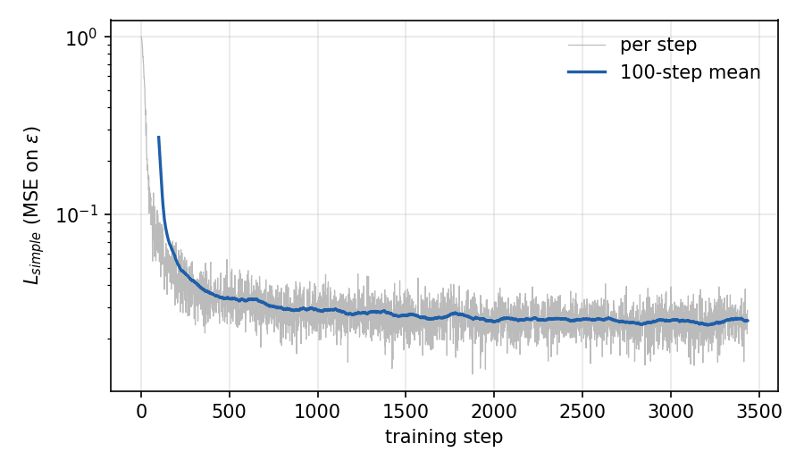
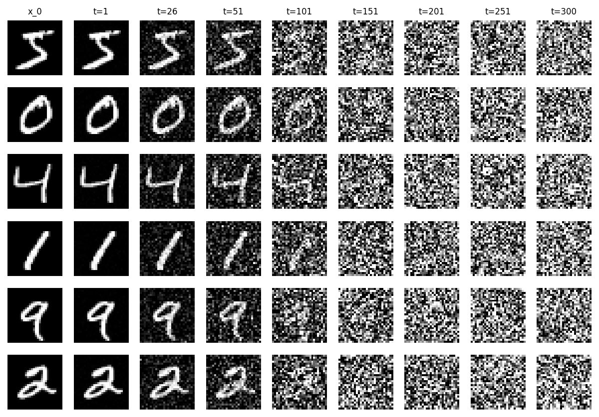
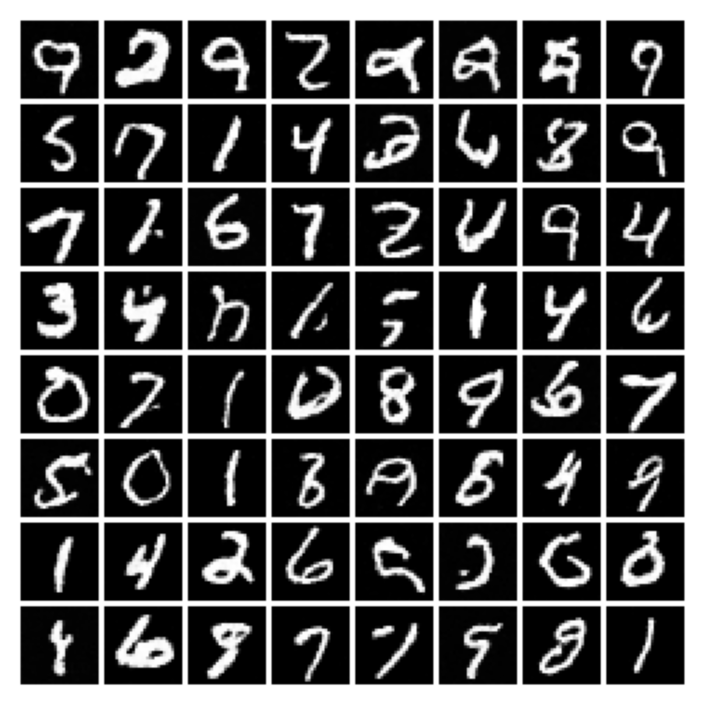
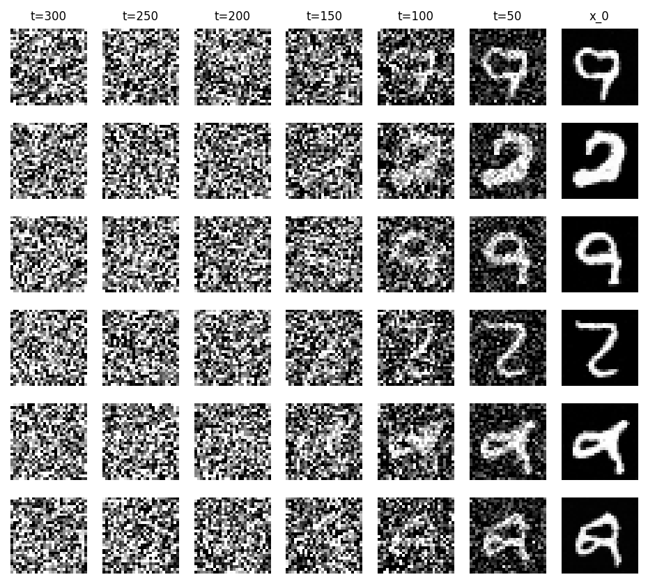

# DDPM

A from-scratch PyTorch implementation of
[Denoising Diffusion Probabilistic Models](https://arxiv.org/abs/2006.11239) (Ho, Jain & Abbeel, NeurIPS 2020),
trained on MNIST on a CPU in 50 minutes.

## The paper

- The forward process adds Gaussian noise over `T` steps with a small increasing schedule `beta_1..beta_T` (Eq. 2), and any step can be sampled directly from `x_0` (Eq. 4):
  `x_t = sqrt(alpha_bar_t) * x_0 + sqrt(1 - alpha_bar_t) * eps`, with `alpha_bar_t = prod_{s<=t} (1 - beta_s)`.
- The reverse process `p_theta(x_{t-1} | x_t)` is a Gaussian whose mean is parameterised through a noise predictor `eps_theta` (Eq. 11).
- The variational bound simplifies to plain regression on the added noise, `L_simple = || eps - eps_theta(x_t, t) ||^2` with `t ~ Uniform{1..T}` (Eq. 14, Algorithm 1).
- Sampling starts from `x_T ~ N(0, I)` and applies the reverse step `T` times, adding `sigma_t z` at every step but the last (Algorithm 2). Here `sigma_t^2 = beta_t`, one of the paper's two choices.

## What's implemented

| File | Contents |
| --- | --- |
| `diffusion.py` | linear beta schedule, closed-form forward process `q_sample` (Eq. 4), training loss (Algorithm 1), ancestral sampler (Algorithm 2) |
| `model.py` | sinusoidal timestep embedding and a small U-Net noise predictor `eps_theta(x_t, t)` |
| `train.py` | training loop (Adam, gradient clipping, EMA of weights), writes the checkpoint and loss curve |
| `sample.py` | loads the EMA weights and writes the sample grid, forward-process and denoising-trajectory figures |
| `test_diffusion.py` | shape tests and statistical checks of the forward process |

## Running

Python 3.11, `torch` (CPU is fine), `torchvision`, `numpy`, `matplotlib`. MNIST goes to `data/` and checkpoints to
`checkpoints/` (both gitignored).

```bash
cd ddpm
python -m unittest -v test_diffusion    # ~4 s; also works with pytest
python train.py --base-ch 32 --threads 7 --minutes 50   # settings used for the results below
python sample.py --threads 7             # writes assets/samples.png, forward_process.png, denoising_trajectory.png
```

`train.py` stops at `--minutes` or `--max-steps`, whichever comes first, so the step count depends on the machine.

## Results

| | This run | Paper (CIFAR-10) |
| --- | --- | --- |
| Data | MNIST 28x28, scaled to [-1, 1] | CIFAR-10 32x32 (also CelebA-HQ, LSUN) |
| `T` | 300 | 1000 |
| beta schedule | linear, 1e-4 to 0.02 rescaled by 1000/T (3.3e-4 to 0.0667) | linear, 1e-4 to 0.02 |
| Network | U-Net, 1.04M params, channels 32/64/128 at 28/14/7, one res block per level, attention at 7x7 only | U-Net, 35.7M params, 2 res blocks per level, attention at 16x16, dropout |
| Optimiser | Adam, lr 1e-3, 200-step warmup, grad clip 1.0 | Adam, lr 2e-4, 5000-step warmup, grad clip 1.0 |
| Batch size | 64 | 128 |
| EMA decay | 0.995 | 0.9999 |
| Training | 3,434 steps (~3.7 epochs), 50.0 min on 7 CPU threads | 800k steps on a TPU v3-8 |

The beta endpoints are rescaled so that the forward process still ends near pure noise with fewer steps
(`alpha_bar_T` is about 3.4e-5 for T=300, versus about 4.0e-5 for the paper's T=1000). The higher learning rate and
faster EMA are there because the run is so short. All figures below are from this run (seed 0), not cherry-picked.

`L_simple` drops from about 1.0 (predicting zero noise) to a mean of **0.0249** over the last 500 steps, and was
still slowly decreasing when the time budget ran out.



Forward process on real digits. The code's `t` is 0-based, so labels show the paper's 1-based step. The digit is
faint at t=101 (alpha_bar about 0.32), essentially gone by t=151, and pure noise by t=300.



64 samples from Algorithm 2 with EMA weights and 300 reverse steps:



The samples look like MNIST (white strokes on black, the right thickness and scale) and most are readable digits
covering all ten classes. Roughly 10-15 of the 64 are malformed strokes that aren't any digit. I didn't measure FID
or log-likelihood. An earlier 22-minute run with a 288k-parameter model (base width 16) gave mostly malformed
strokes, so both width and training time mattered.



The digit shape appears in the last third of the reverse process (between t=100 and t=50), in line with the paper's
observation that large-scale features appear first and details last (Sec. 4.3, Fig. 6).

## Differences from the paper

- About 35x fewer parameters, about 230x fewer training steps, and MNIST instead of CIFAR-10. The paper reports FID
  3.17 and Inception Score 9.46 on CIFAR-10; I measured nothing comparable.
- T = 300 instead of 1000, with the rescaled beta schedule above.
- Same architectural pieces (GroupNorm residual blocks, sinusoidal time embedding added in each block,
  self-attention, skip connections), but one block per resolution, three resolutions, attention only in the
  bottleneck and no dropout.
- Higher learning rate, shorter warmup and a much faster EMA to get something out of a short CPU run.
- More training steps (the loss hadn't plateaued), a wider network (base width 64) and a slower EMA would most likely
  improve the samples. One step of the 1M-parameter model at batch 64 took about 0.87 s on 7 threads.
