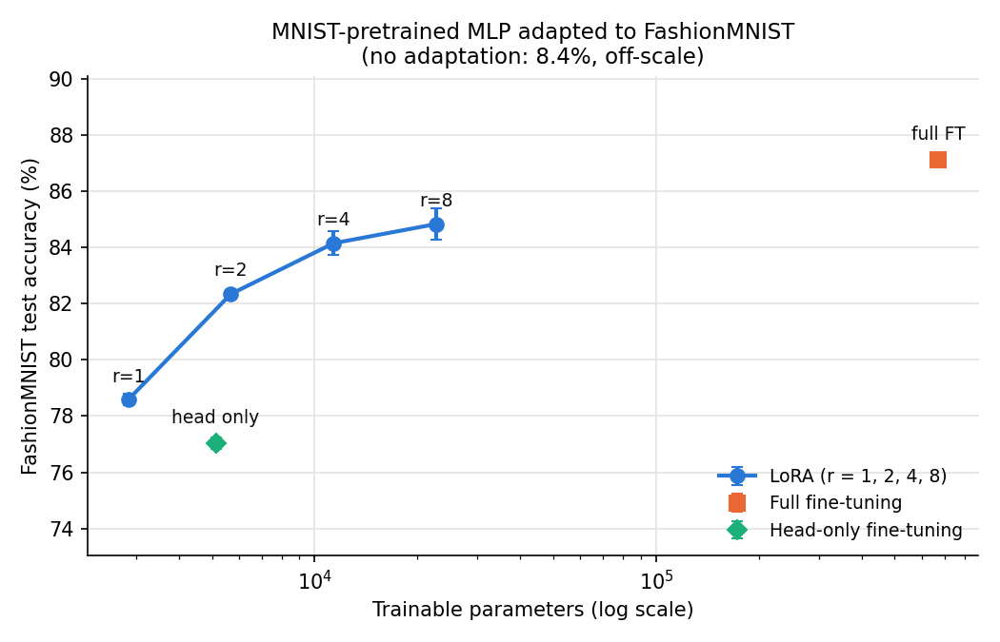

# LoRA

A from-scratch PyTorch implementation of
[LoRA: Low-Rank Adaptation of Large Language Models](https://arxiv.org/abs/2106.09685) (Hu et al., 2021), with tests
and a small CPU experiment comparing LoRA against full fine-tuning. No `peft` or other LoRA library.

## The paper

- The update to a pretrained weight `W0` (d x k) is assumed to have low intrinsic rank, so `W0` is frozen and the update is a rank-`r` product: `h = W0 x + (α / r) · B A x` (Eq. 3), with `B ∈ R^{d x r}`, `A ∈ R^{r x k}`. An adapted layer costs `r(d + k)` trainable parameters instead of `dk`.
- `A` is Gaussian and `B` starts at zero, so training starts from exactly the pretrained function. `A` has to be random, otherwise both gradients are zero.
- Dividing by `r` keeps the update size roughly constant across ranks, so the learning rate doesn't need re-tuning. Here α = 8 for every rank.
- After training, `W = W0 + (α / r) BA` can be merged into the base layer for zero added inference latency (Section 4.1), and subtracted again to swap tasks.

## What's implemented

| File | What it contains |
|---|---|
| `lora.py` | `LoRALinear` (frozen W0, trainable A/B, α/r scaling, dropout, `merge`/`unmerge`), `inject_lora` (swap named `nn.Linear` modules in any `nn.Module` and freeze everything except LoRA), plus small helpers |
| `test_lora.py` | Unit tests: init equals the base layer, merged equals unmerged, only A/B train, parameter-count math |
| `experiment.py` | Pretrains an MLP on MNIST, then adapts it to FashionMNIST with full fine-tuning, head-only fine-tuning and LoRA at r ∈ {1, 2, 4, 8} |
| `results/results.md`, `results/results.json` | Output of the last experiment run |
| `assets/accuracy_vs_params.png` | Accuracy vs. trainable-parameter plot |

```python
from lora import inject_lora, merge_lora, lora_state_dict

model = inject_lora(model, target_modules=["fc1", "fc2", "head"], r=4, alpha=8, dropout=0.0)
# ... train: only lora_A / lora_B have requires_grad=True ...
torch.save(lora_state_dict(model), "adapter.pt")   # just the A/B tensors
merge_lora(model)                                  # W0 += (alpha/r) B A for inference
```

Target names match the full dotted module name (`"encoder.layer.0.attention.query"`) or its last component
(`"query"`), so the same call works on a transformer.

## Running

Python 3.11, PyTorch 2.1 (CPU is fine), torchvision, numpy, matplotlib, pytest.

```bash
cd lora
python -m pytest test_lora.py -v      # or: python test_lora.py
python experiment.py                  # downloads MNIST + FashionMNIST into data/, ~14 min on 2 CPU threads
python experiment.py --plot-only      # redraw the plot from results/results.json
```

The pretrained MNIST model is cached in `checkpoints/mlp_mnist.pt`. The script uses 2 threads.

## Results

An MLP (784 → 512 → 512 → 10, ReLU, 669,706 parameters) is trained on MNIST for 3 epochs (97.33% test accuracy),
then adapted to FashionMNIST, which has the same input shape and number of classes but completely different content.
Every method trains for 3 epochs with AdamW, batch size 128, 3 seeds:

- No adaptation: the MNIST model evaluated on FashionMNIST as-is.
- Head-only: train only the final `Linear` (weights and bias).
- Full fine-tuning: all parameters, lr 1e-3.
- LoRA on `fc1`, `fc2` and `head`, α = 8, no dropout, lr 3e-3. Biases stay frozen, as in the paper.

After each LoRA run the weights are merged and the test set is evaluated again; the script asserts the accuracy is
identical, and it was for every run.

FashionMNIST test accuracy after 3 epochs, mean ± std over 3 seeds (from `results/results.md`):

| Method | Trainable params | % of base model | Test accuracy | Train time / run |
|---|---:|---:|---:|---:|
| No adaptation | 0 | 0.00% | 8.44% | - |
| Head-only | 5,130 | 0.77% | 77.03% ± 0.21 | 19s |
| Full fine-tuning | 669,706 | 100.00% | **87.11% ± 0.14** | 72s |
| LoRA r=1 | 2,842 | 0.42% | 78.58% ± 0.21 | 38s |
| LoRA r=2 | 5,684 | 0.85% | 82.34% ± 0.02 | 40s |
| LoRA r=4 | 11,368 | 1.70% | **84.15% ± 0.42** | 40s |
| LoRA r=8 | 22,736 | 3.39% | 84.83% ± 0.57 | 39s |

Parameter counts check out by hand: r · [(784 + 512) + (512 + 512) + (512 + 10)] = 2,842 · r.



- At r = 4 (1.7% of the parameters) LoRA is within about 3 points of full fine-tuning. r = 8 adds 0.7 points for
  twice the parameters.
- r = 1 (2,842 params) beats head-only (5,130 params) with about half the parameters, and r = 2 (5,684, about the
  same budget) beats it by 5 points. A low-rank update across all layers uses the budget better than a dense update
  to one layer.
- Full fine-tuning still wins. MNIST → FashionMNIST is a big domain shift for a tiny model trained for 3 epochs,
  which is harder for LoRA than the paper's setting of large pretrained language models.
- `lora_r8.pt` is 93 KB vs 2.7 MB for the full model checkpoint.
- LoRA wasn't faster per run: about 40s vs 72s for full fine-tuning, but 2x slower than head-only. On a model this
  small the extra matmuls cost about as much as the saved gradient work. The real savings (no optimizer state or
  gradients for W0, small per-task storage) matter at LLM scale and barely show on a 670K-parameter MLP.

## Differences from the paper

- Toy scale: a 670K-parameter MLP on 28x28 images, not a large language model, so the paper's claims (e.g. matching
  full fine-tuning on GPT-3 with r as low as 1-4) aren't tested here. LLM fine-tuning is in a separate repo.
- Learning rates were picked once (1e-3 full / head-only, 3e-3 LoRA), not tuned per method or rank, and α is fixed
  at 8. A sweep could change the gaps.
- 3 epochs and 3 seeds. Numbers are final-epoch test accuracy (no early stopping or model selection on the test
  set), and the standard deviations come from only 3 runs.
- Only `nn.Linear` is supported. The paper applies LoRA to the attention projections (W_q, W_v); `inject_lora` can
  target those by name, but I didn't run that experiment. Conv and embedding layers aren't handled.
- Train times were measured on a machine shared with other jobs, so treat them as rough.
