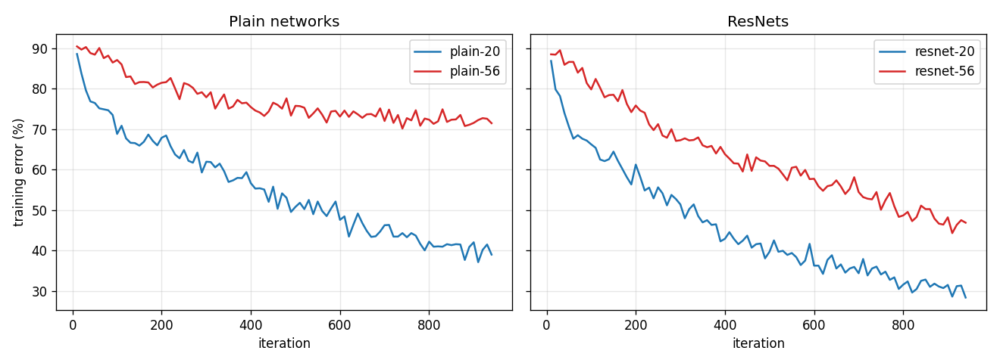

# ResNet

A from-scratch PyTorch implementation of the CIFAR-10 ResNet from
[Deep Residual Learning for Image Recognition](https://arxiv.org/abs/1512.03385) (He et al., 2015), with a small CPU
reproduction of Fig. 6: plain networks get worse as they get deeper and residual networks don't.

## The paper

- Degradation: a 56-layer plain CNN has higher *training* error than a 20-layer one (Fig. 1, Fig. 6), so overfitting doesn't explain it, and with BatchNorm the gradient norms stay healthy (Sec. 4.1). The paper treats it as an optimization problem.
- Residual learning: the stacked layers learn `F(x) = H(x) - x` and the input is added back, `y = relu(F(x) + x)` (Eq. 1), or `relu(F(x) + W_s x)` when shapes change (Eq. 2).
- If the identity is close to optimal, the layers only have to push `F` towards zero, which is easy.
- Identity shortcuts add no parameters or compute, so a ResNet and its plain twin can be compared fairly.

## What's implemented

| File | Contents |
| --- | --- |
| [`model.py`](model.py) | `BasicBlock` (two 3x3 convs + BN, identity shortcut or a 1x1-conv projection when the shape changes, i.e. option B), `CifarResNet` (the 6n+2 layer network of Sec. 4.2), and `resnet(depth)` / `plainnet(depth)`, which build the same network with or without shortcuts. |
| [`train.py`](train.py) | Loads CIFAR-10, trains plain and residual nets at two depths with identical data order, augmentation and hyperparameters, and plots training error. |
| [`test_model.py`](test_model.py) | Shapes, layer counts, parameter count, and a check that the shortcut is really used. |

The network (Sec. 4.2) is a 3x3 conv with 16 filters, three stages of `n` blocks with 16, 32 and 64 filters on 32x32,
16x16 and 8x8 maps (stride-2 convs downsample), global average pooling and a 10-way FC layer: `6n + 2` weighted
layers, so n=3 is ResNet-20 and n=9 is ResNet-56.

## Running

Python 3.11, `torch`, `torchvision`, `numpy`, `matplotlib`. CPU is enough.

```bash
cd resnet
python -m pytest test_model.py        # or: python test_model.py
python train.py                       # quick run (4k subset, 2 epochs); see Results for the command behind the numbers
python train.py --depths 20 32 --subset 10000 --epochs 5   # any two depths of the form 6n+2
```

`train.py` writes `assets/plain_vs_resnet_<A>v<B>.png`, `assets/results_<A>v<B>.json` and one checkpoint per model
in `checkpoints/`.

## Results

Depths 20 and 56 (the shallowest and deepest in Fig. 6), a fixed random 20,000-image subset of the CIFAR-10 training
set, 6 epochs (938 iterations) at batch size 128, SGD with lr 0.1, momentum 0.9, weight decay 1e-4, the paper's
pad-and-crop + flip augmentation, seed 0. All four models see exactly the same mini-batches and augmentations. Test
error is on the full 10,000-image test set. The four runs took 71 minutes in total on 7 CPU threads:

```bash
python train.py --subset 20000 --test-subset 10000 --epochs 6 --batch-size 128 --lr 0.1 --log-every 10 --threads 7
```



*Training error on mini-batches, averaged over every 10 iterations (1,280 images). Left: plain nets. Right: ResNets.
Compare with Fig. 6 of the paper.*

| Model | Layers | Params | Train error, epoch 6 | Test error (10k images) |
| --- | --- | --- | --- | --- |
| plain-20  | 20 | 0.270M | 40.5% | 39.8% |
| plain-56  | 56 | 0.853M | **72.2%** | **70.5%** |
| ResNet-20 | 20 | 0.272M | 31.0% | 37.2% |
| ResNet-56 | 56 | 0.856M | 47.9% | 45.8% |

"Train error, epoch 6" is the mean over all mini-batches of the last epoch, on augmented images, before each weight
update. Test error is measured afterwards in eval mode. Per-iteration numbers are in
[`assets/results_20v56.json`](assets/results_20v56.json).

The degradation problem shows up clearly. With the same data, optimizer and budget, plain-56 has much higher training
error than plain-20 (72.2% vs 40.5%) and flattens out at about 72% after ~500 iterations while plain-20 keeps
improving. Adding identity shortcuts to the same 56-layer network removes the plateau: ResNet-56 ends at 47.9%, 24
points better than plain-56, with only 0.003M extra parameters (the two 1x1 projection shortcuts). At 20 layers the
shortcuts help less (40.5% vs 31.0%), which fits the paper's observation that moderate-depth plain and residual nets
behave more similarly.

What didn't reproduce: in the paper ResNet-56 beats ResNet-20 (6.97% vs 8.75% test error). Here it's still behind
(45.8% vs 37.2%). Deeper nets converge more slowly early on and this run is about 1.5% of the paper's 64k
iterations. ResNet-56's curve is still falling steeply at the end while plain-56's is flat, but showing the
crossover needs a GPU-scale run. Only one seed was run.

## Differences from the paper

| | Paper (Sec. 4.2) | Here |
| --- | --- | --- |
| Training data | 45k train / 5k val split | 20,000-image subset |
| Training length | 64k iterations (~164 epochs), lr /10 at 32k and 48k | 938 iterations (6 epochs over the subset), constant lr |
| Batch size / lr | 128 / 0.1 | 128 / 0.1 |
| Shortcuts when shape changes | Option A (zero-padded identity, no parameters) | Option B (1x1 projection conv + BN) |
| Input normalization | per-pixel mean subtraction | per-channel mean/std |
| Test set | full 10k | full 10k |
| Final errors | ~7-9% test error | ~37-71% test error: early in training |

The absolute numbers aren't comparable to the paper; the relative ordering of the curves is what matters here. On a
GPU, increase `--subset` and `--epochs` (and add the paper's lr drops) to get closer to the paper's setting.
