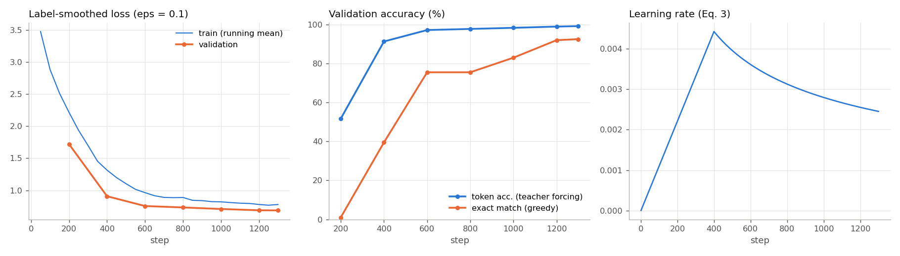
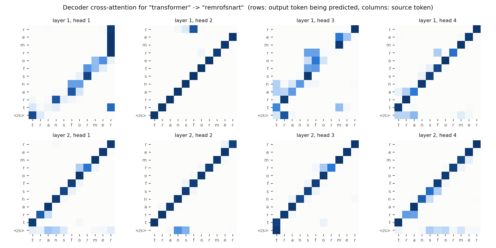

# Transformer

A from-scratch PyTorch implementation of the encoder-decoder Transformer from
[Attention Is All You Need](https://arxiv.org/abs/1706.03762) (Vaswani et al., 2017), trained on CPU to reverse
strings. No `nn.Transformer` or `nn.MultiheadAttention`.

## The paper

- Attention replaces recurrence, so every position sees every other in one step and a sequence is processed in parallel (Section 4).
- Scaled dot-product attention, `softmax(QK^T / sqrt(d_k)) V` (Eq. 1); the `1/sqrt(d_k)` stops large logits from saturating the softmax.
- Multi-head attention runs `h` attention functions on `d_model/h`-dimensional projections and concatenates them (Section 3.2.2).
- Attention has no notion of order, so fixed sinusoidal encodings are added to the embeddings (Section 3.5).
- Training uses Adam with `beta2 = 0.98`, warmup then `1/sqrt(step)` decay (Eq. 3), residual dropout and label smoothing with `eps = 0.1`.

## What's implemented

| File | Contents |
|---|---|
| `model.py` | Attention, multi-head attention, FFN, positional encoding, encoder/decoder layers, masks, `Transformer`, greedy decoding, `LabelSmoothingLoss`, `noam_lr` |
| `data.py` | The reversal task: vocabulary, fixed-seed splits cached in `data/`, `Dataset` and padding `collate` |
| `train.py` | Training loop, evaluation, plots, sample predictions, checkpoint |
| `test_model.py` | 17 shape, mask, loss and schedule tests |
| `assets/` | `loss.png`, `attention.png`, `samples.txt`, `metrics.json` (all numbers below come from this file) |

It's post-norm like the paper, with tied source/target/output embeddings scaled by `sqrt(d_model)` (Section 3.4).
Masks are boolean with `True` meaning "may attend"; blocked scores are set to `-inf`, so they get exactly zero weight.
Q/K/V each use one `d_model x d_model` layer reshaped into `h` heads, which is equivalent to separate projections.
Adam's base lr is 1.0 and `LambdaLR` multiplies it by `noam_lr(step)`, so the schedule is exactly Eq. 3.

The tests go beyond shapes: changing target token 4 must leave decoder outputs 0-3 unchanged, padding the source
(alone or inside a batch) must not change the logits, label smoothing must match a hand-built distribution, and the
LR must peak at exactly `warmup_steps`. I removed the causal mask and then the padding mask to check that the mask
tests fail without them.

## Running

Python 3.11, PyTorch 2.x (CPU is fine), numpy, matplotlib.

```bash
cd transformer
python test_model.py        # or: pytest test_model.py
python train.py             # ~12 min training on 2 CPU threads; writes assets/ and checkpoints/
python train.py --steps 200 # quick smoke test
```

## Results

The task is reversing lowercase strings (`transformer -> remrofsnart`). The vocabulary is 26 letters plus `<pad>`,
`<s>`, `</s>` (29 tokens). Train, validation
and test are 50,000, 1,000 and 2,000 disjoint random strings of length 4-16, plus a "long" set of 500 strings of
length 17-24. Reversal forces position-based cross-attention, which should show up as an anti-diagonal.

Config: `d_model=128, h=4, N=2` encoder and decoder layers, `d_ff=512`, dropout 0.1, label smoothing 0.1, batch 64,
warm-up 400 steps, 1,300 steps, 929,437 parameters. Training took 730 s (12.2 min), including periodic validation,
on 2 CPU threads of a shared machine.

| Metric (test set, 2,000 strings, length 4-16) | Value |
|---|---|
| Exact-match sequence accuracy (greedy decoding) | **89.9 %** |
| Per-token accuracy (teacher forcing) | 99.04 % |
| Label-smoothed loss | 0.689 |
| Final training loss (mean of last 50 steps, with dropout) | 0.778 |
| Exact match on longer strings (length 17-24, never seen) | 2.0 % |

| length | 4 | 5 | 6 | 7 | 8 | 9 | 10 | 11 | 12 | 13 | 14 | 15 | 16 | 17 | 18-24 |
|---|---|---|---|---|---|---|---|---|---|---|---|---|---|---|---|
| exact match % | 92.1 | 94.6 | 93.3 | 94.6 | 95.4 | 93.8 | 88.2 | 87.9 | 87.9 | 87.9 | 88.6 | 85.0 | 78.5 | 18.5 | 0.0 |

With `eps = 0.1` over 27 alternative tokens, the loss can't go below the entropy of the smoothed target (about
0.655), so 0.689 is close to the floor. One wrong token out of up to 17 fails the whole sequence, which is why 99 %
token accuracy becomes about 90 % exact match and the longest in-distribution strings do worst.
The run hadn't converged: exact match on a 200-string validation subset went from 83.0 % at step 1,000 to 92.5 % at
step 1,300, and I stopped there to stay under 15 minutes.

Length generalisation fails: 18.5 % at length 17 and 0 % beyond. The median output length on the long set is 16, so
the model mostly stops at the longest length it trained on, and about 11 % of outputs contain a run of 3 or more
identical characters (`assets/samples.txt`). It never learned to use positions beyond 16 (17 on the decoder side),
a known weakness of absolute positional encodings.



The right panel is the Eq. 3 schedule, peaking at 4.4e-3 at step 400.



Cross-attention for the input `transformer` (rows are output tokens, columns are source tokens). In layer 1, heads
2 and 4 already show the anti-diagonal and heads 1 and 3 are noisier; in layer 2 all four heads use it.

```
jzrtsbipofwh     -> hwfopibstrzj     [ok]
kyoyrsyofon      -> nofoysryoyk      [ok]
uwyuyhjpmraunujv -> vjunuarmpjhyuywu [ok]
mrhogktdtczkk    -> kkkzctkgohrm     [WRONG, expected kkzctdtkgohrm]
ppdzczjqeanwvwddu -> udwvwnaeqjzczdpppppppppppp   (length 17, unseen)
```

## Differences from the paper

| | Paper (base model) | Here |
|---|---|---|
| Task / data | WMT14 En-De / En-Fr, BPE vocab of ~37k | String reversal, 29-token char vocab |
| Layers `N` | 6 encoder + 6 decoder | 2 + 2 |
| `d_model` / `d_ff` / heads | 512 / 2048 / 8 | 128 / 512 / 4 |
| Parameters | ~65M | 0.93M |
| Batch | ~25k source + 25k target tokens | 64 sequences (~700 target tokens) |
| Training | 100k steps on 8 P100 GPUs | 1,300 steps on 2 CPU threads |
| Warm-up steps | 4000 | 400 |
| Decoding | Beam search (beam 4, length penalty 0.6) | Greedy |
| Checkpoint averaging | Last 5 checkpoints averaged | Not used |
| Initialisation | Not specified | Xavier-uniform |

Everything else follows the paper, including Adam `(0.9, 0.98, 1e-9)` and dropout of 0.1 on residuals, embeddings
and attention weights. The paper doesn't mention attention dropout explicitly, but tensor2tensor uses it.
