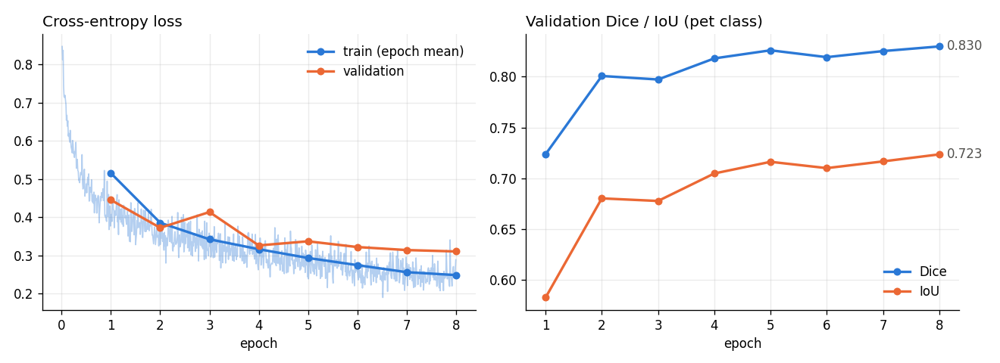
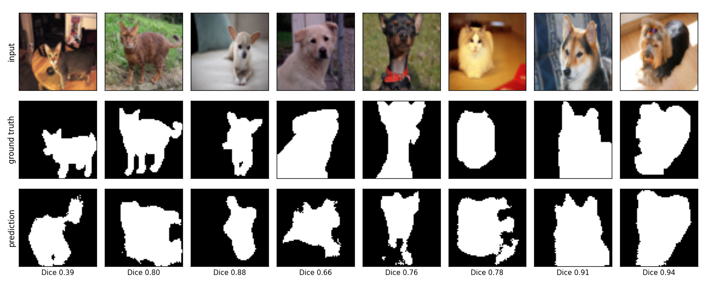

# U-Net

A from-scratch PyTorch implementation of [U-Net](https://arxiv.org/abs/1505.04597) (Ronneberger, Fischer & Brox,
2015), trained on CPU for pet-vs-background segmentation on the Oxford-IIIT Pet dataset.

## The paper

- The contracting path repeats two 3x3 convs + ReLU and a 2x2 max pool, halving resolution and doubling channels (64 → 128 → 256 → 512 → 1024).
- The expanding path upsamples with a learned 2x2 up-convolution that halves the channels, then applies two 3x3 convs.
- Encoder features at the same resolution are concatenated onto the decoder features, bringing back the spatial detail lost to pooling.
- A 1x1 conv maps each pixel to class scores, trained with pixel-wise softmax + cross-entropy; with no dense layers any valid input size works.
- The paper uses unpadded convs (572x572 in, 388x388 out) with center-cropped skips, elastic augmentation and a border weight map, because it trains on only 30 images.

## What's implemented

| File | Contents |
|---|---|
| `model.py` | `DoubleConv`, `Down`, `Up`, `UNet`, `center_crop`, `dice_score`, `iou_score` |
| `dataset.py` | Downloads Oxford-IIIT Pet, converts trimaps to binary masks, resizes and caches |
| `train.py` | Training loop, evaluation, plots, `assets/metrics.json` |
| `test_model.py` | Shape tests (incl. the paper's 572 → 388), crop, gradients, metric tests |

`UNet(padding=False, batch_norm=False, base_channels=64, depth=4, in_channels=1)` is the exact Figure 1 network:
31,030,658 parameters, 572x572 → 388x388 (checked in `test_model.py`).

## Running

Python 3.11, PyTorch 2.1, torchvision, numpy, matplotlib, tqdm, pytest.

```bash
cd unet
python -m pytest test_model.py -v   # 12 tests, ~20 s on CPU
python train.py                     # downloads data to data/, trains, writes assets/
python train.py --help              # width, depth, epochs, image size, subset, ...
```

The first run downloads the dataset (~800 MB) into `data/` and resizes all 7,349 images once into `data/pets_64.pt`.
That took about 8 minutes on my machine; later runs load the cache in seconds. The best checkpoint (by validation
Dice) goes to `checkpoints/unet.pt`.

## Results

64x64 RGB images, `base_channels=8`, depth 4, padded convs + BatchNorm (486,562 parameters), Adam (lr 1e-3, cosine
decay), batch 32, 8 epochs, random horizontal flips. 3,312 training / 368 validation images (a seeded split of the
official `trainval` set), evaluated on the official 3,669-image `test` split. CPU only, 2 threads: training took
647 s (~11 minutes).

| Split | Cross-entropy | Dice (pet) | IoU (pet) |
|---|---|---|---|
| Validation (epoch 8) | 0.3100 | 0.8299 | 0.7235 |
| **Test** (best val checkpoint, epoch 8) | **0.2976** | **0.8327** | **0.7296** |

Dice and IoU are computed per image for the pet class and averaged. Trimap "boundary" pixels count as pet. Single
run (seed 0); numbers are also in `assets/metrics.json`.



Evenly spaced test images, not cherry-picked (the test split is sorted by breed, so this covers several breeds):



At 64x64 with 0.5M parameters the model finds the pet reliably but misses thin structures like tails and ears, and
cluttered backgrounds confuse it (first column). Validation loss was still falling at epoch 8, so more epochs, a
wider model or larger images should help. I didn't try those because of the CPU time budget.

## Differences from the paper

| Paper | Here | Why |
|---|---|---|
| Unpadded (valid) 3x3 convs, crop skips | Padded convs by default (`padding=True`); valid mode is implemented and tested | Output has the input's size, so no overlap-tile inference or target cropping is needed for small 64x64 images |
| No normalization | BatchNorm after each conv (`batch_norm=True`, can be turned off) | Faster, more stable training for a narrow model with a few epochs |
| Base width 64 (31M params) | Base width 8 (0.5M params), configurable | Has to train on 2 CPU threads in about 10 minutes |
| SGD, momentum 0.99, batch of 1 large tile | Adam, lr 1e-3, cosine schedule, batch 32 | Small images batch well; Adam needs less tuning |
| Weighted cross-entropy with a border weight map (Eq. 1–2) | Plain cross-entropy | The weight map separates touching cells. Pets are single objects, so it doesn't apply |
| Elastic deformations, shifts, rotations, gray-value changes | Random horizontal flip only | Thousands of training images instead of 30 |
| Overlap-tile strategy for large images | Whole (resized) image in one pass | 64x64 inputs fit in one pass |
| Drop-out at the end of the contracting path | None | Kept the model minimal; overfitting was not the bottleneck at this size |
| Grayscale microscopy (ISBI EM, cell tracking) | RGB Oxford-IIIT Pet, binary pet/background | Small, downloads reliably via torchvision, trains on CPU |

The rest matches the paper, including center-cropped skips in valid mode, 2-class softmax + cross-entropy and He
initialization (std = sqrt(2/N), Section 3).
