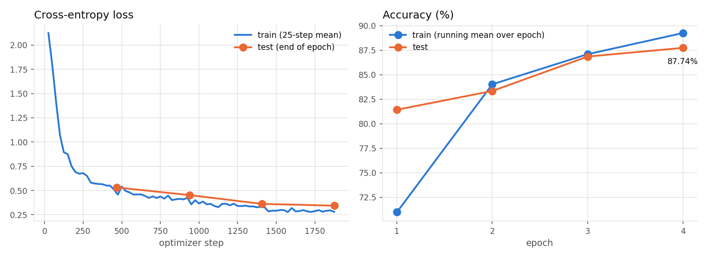
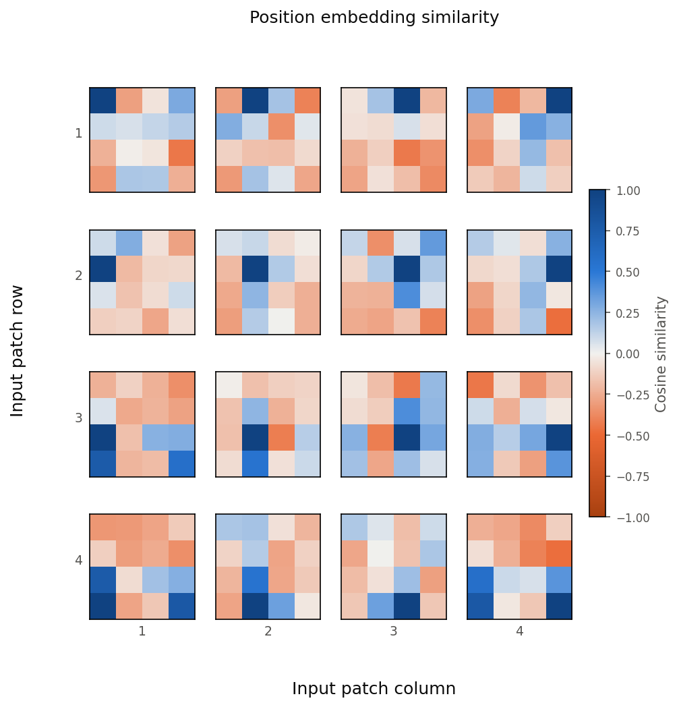
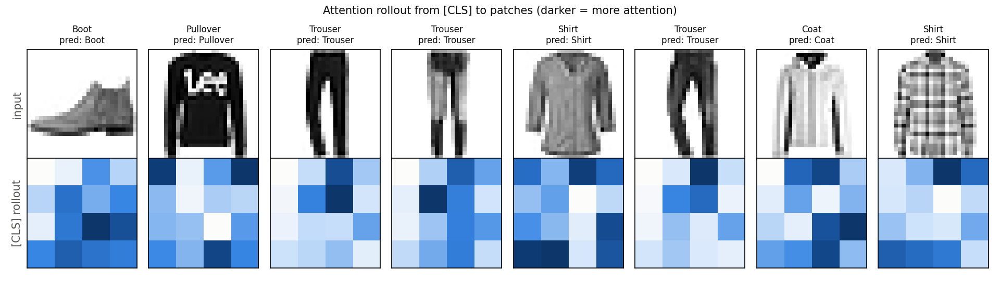

# Vision Transformer (ViT)

A from-scratch PyTorch implementation of
[An Image is Worth 16x16 Words](https://arxiv.org/abs/2010.11929) (Dosovitskiy et al., 2020), trained on
FashionMNIST on CPU. No `nn.MultiheadAttention` or `nn.TransformerEncoder`.

## The paper

- The image is cut into non-overlapping P x P patches and each one is flattened and linearly projected to a D-dim token. With P = 7 a 28x28 image becomes 16 tokens, so here it's worth 4x4 words.
- A learnable [CLS] token is prepended and learned 1-D position embeddings are added (Eq. 1); the model has to work out the 2-D layout itself.
- The encoder is a standard pre-norm Transformer, `x + MSA(LN(x))` then `x + MLP(LN(x))` (Eqs. 2-3), and the final [CLS] state goes through LayerNorm and a linear head (Eq. 4).
- Apart from patchification nothing builds in locality, which is why the paper needs ImageNet-21k / JFT-300M pre-training to beat CNNs.

## What's implemented

| File | Contents |
|---|---|
| `model.py` | `PatchEmbedding`, `MultiHeadSelfAttention`, `MLP`, `EncoderBlock`, `ViT` |
| `train.py` | FashionMNIST training loop (AdamW, linear warmup + cosine decay), evaluation, saves metrics/plots/checkpoint |
| `visualize.py` | Training curves, position-embedding similarity (Fig. 7), attention rollout (Fig. 6 / App. D.8) |
| `test_model.py` | Shape tests, a check that the Conv2d patch embedding equals "flatten + linear", attention rows sum to 1, gradient flow |

## Running

Python 3.11, `torch` (CPU is enough), `torchvision`, `numpy`, `matplotlib`, `pytest`.

```bash
cd vit
python -m pytest test_model.py        # unit tests
python train.py                       # downloads FashionMNIST to vit/data/, trains, writes vit/assets/
python visualize.py                   # optional: regenerate plots from vit/checkpoints/
```

`train.py` uses 2 threads by default (`--threads`) and stops after `--time-budget-min` (default 13 min). Every
hyperparameter is a CLI flag.

## Results

Config: patch 7 (16 patches + [CLS] = 17 tokens), D = 64, depth 4, 4 heads, MLP dim 128, 139,018 parameters.
Batch 128, AdamW (lr 3e-3, weight decay 0.05), 200 warmup steps then cosine decay, gradient clipping at 1.0,
4 epochs, no augmentation, no dropout, seed 0. CPU only, 2 threads, on a machine shared with other jobs.

| Epoch | Train acc (running) | Test loss | Test acc |
|---|---|---|---|
| 1 | 70.98% | 0.5313 | 81.43% |
| 2 | 84.02% | 0.4529 | 83.34% |
| 3 | 87.09% | 0.3622 | 86.85% |
| 4 | 89.25% | 0.3437 | **87.74%** |

Final test accuracy is 87.74% on the full 10k test set. Training plus per-epoch evaluation took 4.89 min. An
earlier run of the same seeded config gave identical accuracies but took 8.71 min under heavier CPU contention.
Raw numbers are in `assets/metrics.json`. Test accuracy was still rising at the last epoch, so this is limited by
compute rather than converged, and I didn't train a CNN baseline to compare against.



**Position-embedding similarity** (cf. paper Fig. 7, center). Each panel is the cosine similarity between one
patch's position embedding and all 16. Apart from the diagonal the structure is weak and noisy, with some grouping
in the bottom two rows. That's far from the clean row/column pattern in the paper, which trained much longer on
much more data.



**Attention rollout from [CLS]** (cf. paper Fig. 6 / Appendix D.8), using the same method as the paper (Abnar &
Zuidema, 2020): average over heads, add the identity for the residual, re-normalize rows, multiply across layers.
All 8 of the first test images are classified correctly and attention sits on the garment (trouser legs, shirt and
coat bodies). The 4x4 grid makes the maps coarse.



## Differences from the paper

| | Paper | This implementation |
|---|---|---|
| Data | ImageNet / ImageNet-21k / JFT-300M pre-training, then fine-tuning | FashionMNIST (28x28 grayscale) from scratch, no pre-training |
| Patch size / tokens | 16x16 (or 14, 32) on 224x224 -> 196 tokens | 7x7 on 28x28 -> 16 tokens |
| Model size | ViT-B/L/H: D = 768-1280, 12-32 layers, 86M-632M params | D = 64, 4 layers, 4 heads, 139K params |
| Optimizer | Adam (β2 = 0.999), weight decay 0.1, batch 4096 for pre-training; SGD with momentum for fine-tuning | AdamW, weight decay 0.05 (not applied to biases, LayerNorm, [CLS], position embeddings), batch 128 |
| Schedule | Linear warmup 10k steps, linear or cosine decay | 200 warmup steps, cosine decay, 4 epochs (1,876 steps) |
| Regularization | Dropout, plus heavy augmentation in follow-up work (DeiT) | None (dropout = 0, no augmentation). See note below |
| Head | MLP with one hidden layer for pre-training, single linear layer for fine-tuning | Single linear layer |
| Patch projection | Linear layer on flattened patches | `Conv2d(kernel=stride=P)`, mathematically identical (verified in `test_model.py`) |
| Resolution change | 2-D interpolation of position embeddings for fine-tuning at higher resolution | Not implemented (fixed 28x28) |

Why this config: my first attempt used 4x4 patches (49 tokens), random crop + horizontal flip and lr 1e-3, planned
for 3 epochs. Under heavy CPU contention the 13-minute guard stopped it partway through epoch 3, before the cosine
schedule finished, at 74.88% test accuracy. In a quick benchmark at depth 6, 7x7 patches took 249 ms per step
against 714 ms for 4x4, which made room for 4 full epochs with a complete LR schedule. Dropping augmentation also
sped up early learning in this short run.
